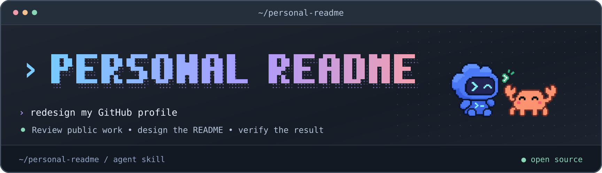
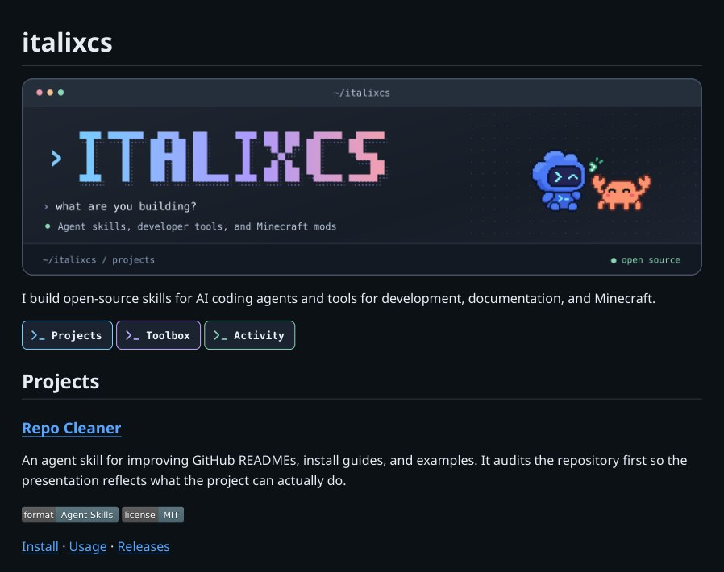

# Personal README



An Agent Skill for creating, redesigning, and auditing GitHub profile READMEs. It builds the profile around the developer’s public work and checks the claims, links, visuals, and reading order.

<a href="docs/installation.md"></a>
<a href="docs/italixcs-example.md"></a>
<a href="docs/validation.md"></a>

## Getting started

Clone or download this repository from GitHub’s **Code** menu. If you use GitHub CLI, run:

```sh
gh repo clone \
  italixcs/Personal-README-skill
cd Personal-README-skill
```

Open the folder with an agent that can read local files and give it a task.

> Read skills/personal-readme/SKILL.md. Redesign the GitHub profile for owner/handle. Keep the current public identity and featured project. Compare the old and new layouts.

For Codex or Claude Code discovery, see the [installation guide](docs/installation.md). The [skill folder](skills/personal-readme) includes the instructions, references, and license.

## What it produces

- A profile README with sourced descriptions of public projects and direct links readers can use.
- A visual direction with local assets, including badges, stack icons, or an original banner when they fit the profile.
- A reviewable comparison for redesigns when rendering is available, with checks for mobile, themes, links, and asset fallbacks.

## Example redesign

[](docs/italixcs-example.md)

The profile restores developer buttons and toolbox icons, adds recently published skills, and puts GitHub metrics beside a link to the live contribution graph. [See the design decisions](docs/italixcs-example.md).

The skill has no runtime dependencies. GitHub access, image generation, and visual rendering are optional host capabilities. Use [Repo Cleaner](https://github.com/italixcs/Repo-cleaner) for a project repository’s README, wider documentation, and metadata.

[Design research](docs/design-research.md) · [MIT License](LICENSE)
