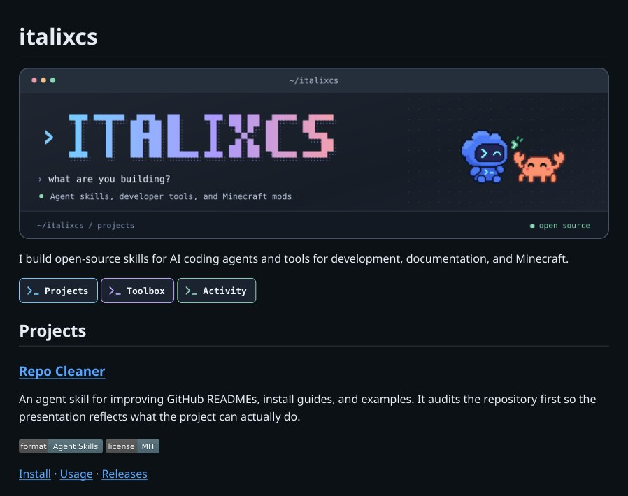

# Example profile redesign

**Brief.** Redesign the Italixcs profile with the look of a terminal coding agent. Bring back buttons and stack icons, include recently published public projects, and add a compact GitHub activity section.

**Input.** The [original README](https://github.com/italixcs/Italixcs/blob/c12b5b7a5172303d7ecd8fe413f8db7c6a4c3913/README.md) opens with a charcoal terminal illustration and a Repo Cleaner showcase. An [older profile revision](https://github.com/italixcs/Italixcs/blob/7762a87/README.md) includes the developer badges and toolbox icons.

**Design.** Use an original pixel wordmark, terminal prompt, and two pixel-art pets. Restore the toolbox assets and add linked navigation. Feature Repo Cleaner first with an expandable Seed Atlas case study beside its install and usage links. Add Project Memory, Doc Designer, Skill Development, Personal README, and Seed Atlas with direct public repository links.

**Activity.** The repository and star counts are a dated snapshot of the public GitHub repository list. The contribution graph links directly to GitHub.

